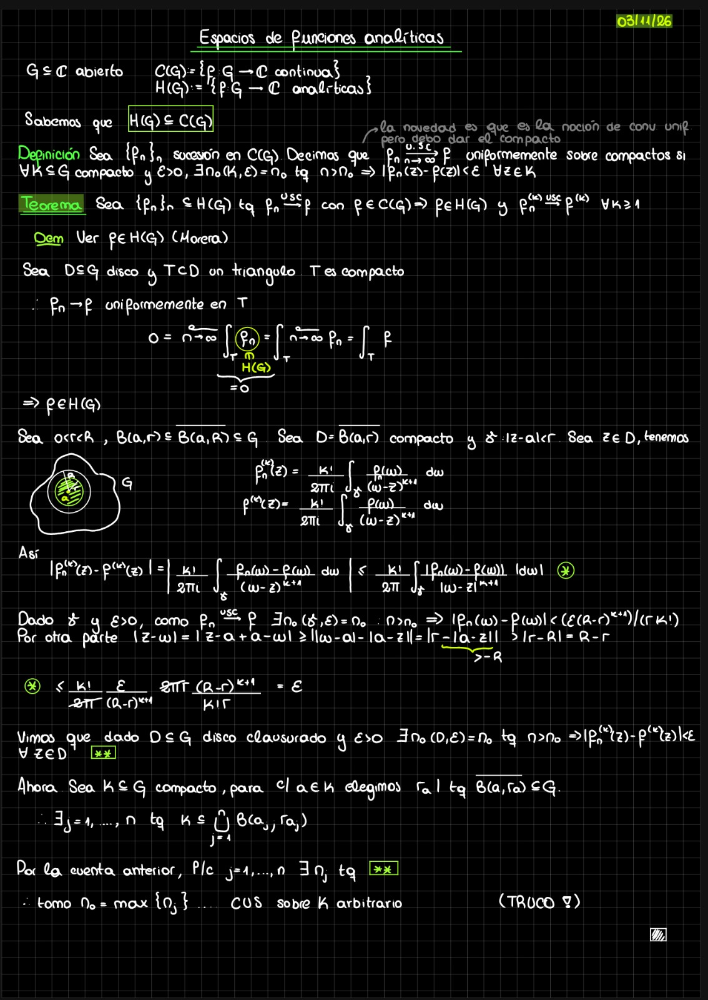
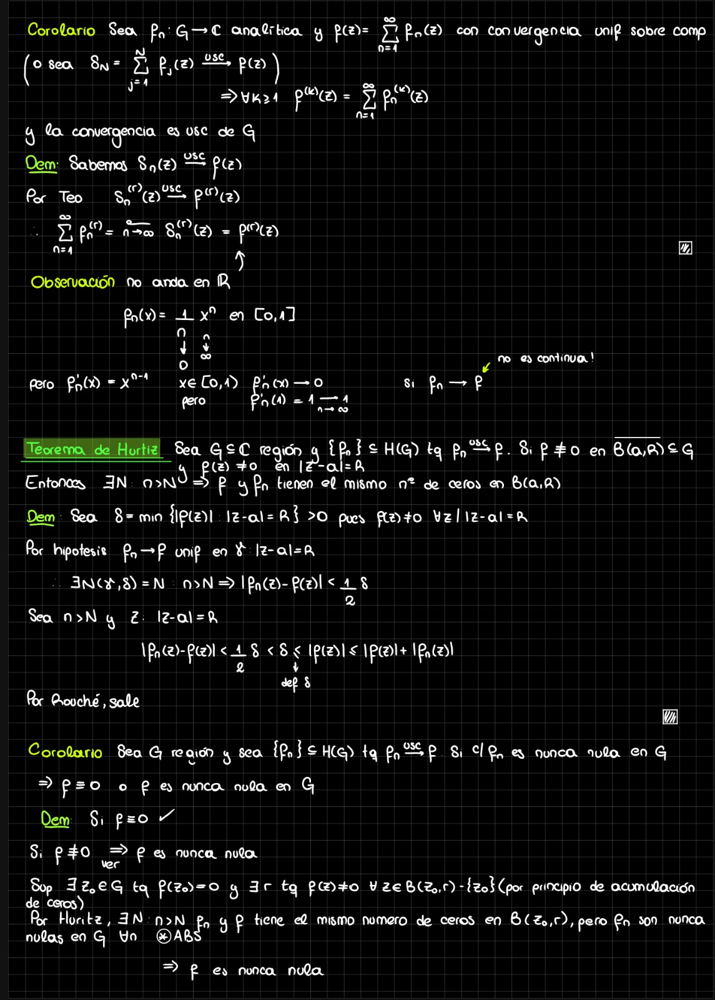
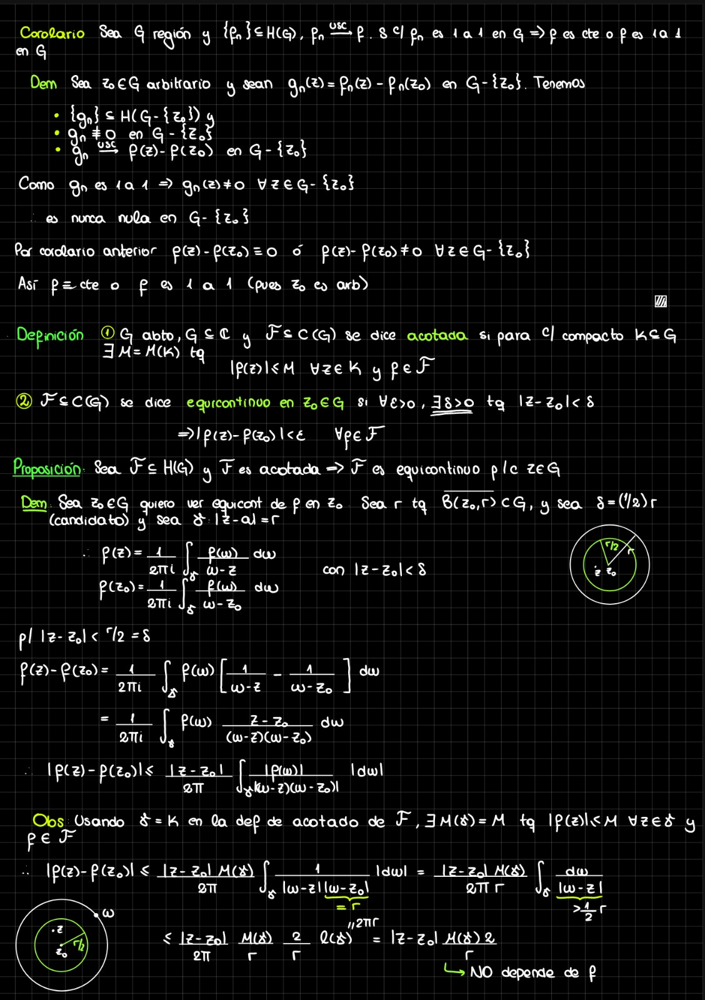
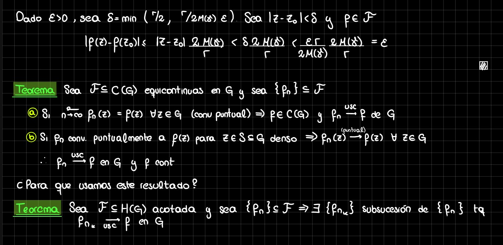

# Teo 17 — Espacios de funciones analíticas (03/11/2026)

> [!remark] Fuente y criterio de transcripción
> Transcripción de las 4 fotos del pizarrón enviadas por Shansy al grupo Analíticas por WhatsApp el 03/11/2026 a las 22:17, continuación de [[FA - Teo16]]. En el envío, la foto 2 trae el título y la fecha (03/11/26) y abre la clase; se sigue el orden 2–1–3–4. Las fotos originales están al final en `Adjuntos/FA-Teo17/` renombradas en ese orden.

## 1. Convergencia uniforme sobre compactos

Sea $G\subseteq\mathbb{C}$ abierto. Definimos $$C(G)=\{f:G\to\mathbb{C}\text{ continua}\},\qquad H(G)=\{f:G\to\mathbb{C}\text{ analítica}\}.$$

Sabemos que $H(G)\subseteq C(G)$. La novedad es la noción de convergencia uniforme, pero hay que dar el compacto.

>[!definition] Convergencia uniforme sobre compactos
>Sea $\{f_n\}_n$ una sucesión en $C(G)$. Decimos que $f_n\xrightarrow[n\to\infty]{usc}f$ (uniformemente sobre compactos) si para todo $K\subseteq G$ compacto y todo $\varepsilon>0$ existe $n_0(K,\varepsilon)=n_0$ tal que $n>n_0\Rightarrow |f_n(z)-f(z)|<\varepsilon$ para todo $z\in K$.

^a17b01

>[!theorem] Límite usc de analíticas y convergencia de las derivadas
>Sea $\{f_n\}_n\subseteq H(G)$ tal que $f_n\xrightarrow{usc}f$ con $f\in C(G)$. Entonces $f\in H(G)$ y $f_n^{(k)}\xrightarrow{usc}f^{(k)}$ para todo $k\geq1$.
>
>>[!Proof]-
>>1. **$f$ es analítica (Morera).** Sea $D\subseteq G$ un disco y $T\subseteq D$ un triángulo; $T$ es compacto, luego $f_n\to f$ uniformemente en $T$. Como cada $f_n\in H(G)$, $$0=\lim_{n\to\infty}\int_T f_n=\int_T\lim_{n\to\infty}f_n=\int_T f.$$ Por Morera, $f\in H(G)$.
>>2. **Fórmula de Cauchy en un disco cerrado.** Sean $0<r<R$ con $B(a,r)\subseteq\overline{B(a,R)}\subseteq G$. Ponemos $D=\overline{B(a,r)}$, compacto, y $\gamma:|z-a|=R$ (el pizarrón trae un dibujo de $D$ dentro de $\gamma$ dentro de $G$). Para $z\in D$ valen $$f_n^{(k)}(z)=\frac{k!}{2\pi i}\int_\gamma\frac{f_n(w)}{(w-z)^{k+1}}\,dw,\qquad f^{(k)}(z)=\frac{k!}{2\pi i}\int_\gamma\frac{f(w)}{(w-z)^{k+1}}\,dw.$$
>>3. **Estimación.** Así $$\big|f_n^{(k)}(z)-f^{(k)}(z)\big|=\left|\frac{k!}{2\pi i}\int_\gamma\frac{f_n(w)-f(w)}{(w-z)^{k+1}}\,dw\right|\leq\frac{k!}{2\pi}\int_\gamma\frac{|f_n(w)-f(w)|}{|w-z|^{k+1}}\,|dw|.\qquad (\ast)$$
>>4. **Cota inferior de $|w-z|$.** Por otra parte $|z-w|=|z-a+a-w|\geq\big||w-a|-|a-z|\big|=|R-|a-z||=R-|a-z|\geq R-r$, pues $w\in\gamma$ y $|a-z|\leq r<R$ para $z\in D$.
>>5. **Elección de $n_0$.** Dado $\gamma$ y $\varepsilon>0$, como $f_n\xrightarrow{usc}f$ existe $n_0(\gamma,\varepsilon)=n_0$ tal que $n>n_0\Rightarrow |f_n(w)-f(w)|<\varepsilon(R-r)^{k+1}/(rk!)$ para $w\in\gamma$.
>>6. **Convergencia uniforme en $D$.** Con el paso 4, $(\ast)\leq\frac{k!}{2\pi(R-r)^{k+1}}\cdot\frac{\varepsilon(R-r)^{k+1}}{rk!}\cdot\ell(\gamma)=\varepsilon$, pues $\ell(\gamma)=2\pi r$. Vimos que dado $D\subseteq G$ disco clausurado y $\varepsilon>0$ existe $n_0(D,\varepsilon)=n_0$ tal que $n>n_0\Rightarrow\big|f_n^{(k)}(z)-f^{(k)}(z)\big|<\varepsilon$ para todo $z\in D$. $(\ast\ast)$
>>7. **Truco: de discos a un compacto arbitrario.** Sea ahora $K\subseteq G$ compacto; para cada $a\in K$ elegimos $r_a$ tal que $\overline{B(a,r_a)}\subseteq G$. Entonces existen $a_1,\dots,a_n$ tales que $K\subseteq\bigcup_{j=1}^n B(a_j,r_{a_j})$. Por la cuenta anterior, para cada $j=1,\dots,n$ existe $n_j$ tal que $(\ast\ast)$ vale en $\overline{B(a_j,r_{a_j})}$. Tomando $n_0=\max\{n_j\}$ se obtiene CUS sobre el compacto $K$ arbitrario (TRUCO!).

^a17b02

## 2. Derivación término a término y Hurwitz

>[!proposition] Corolario: derivación de series
>Sea $f_n:G\to\mathbb{C}$ analítica y $f(z)=\sum_{n=1}^\infty f_n(z)$ con convergencia uniforme sobre compactos (o sea $S_N=\sum_{j=1}^N f_j(z)\xrightarrow{usc}f(z)$). Entonces para todo $k\geq1$ vale $f^{(k)}(z)=\sum_{n=1}^\infty f_n^{(k)}(z)$ y la convergencia es USC en $G$.
>
>>[!Proof]-
>>1. **Sumas parciales.** Sabemos $S_n(z)\xrightarrow{usc}f(z)$; por el teorema, $S_n^{(r)}(z)\xrightarrow{usc}f^{(r)}(z)$. Luego $$\sum_{n=1}^\infty f_n^{(r)}=\lim_{n\to\infty}S_n^{(r)}(z)=f^{(r)}(z).$$

^a17b03

>[!remark] Observación: en $\mathbb{R}$ no anda
>Con $f_n(x)=\frac1n x^n$ en $[0,1]$ se tiene $f_n'(x)=x^{n-1}$; para $x\in[0,1)$ vale $f_n'(x)\to0$, pero $f_n'(1)=1\to1$. Es decir, si $f_n'\to f$, el límite no es continuo.

>[!theorem] Teorema de Hurwitz
>Sea $G\subseteq\mathbb{C}$ región y $\{f_n\}\subseteq H(G)$ tal que $f_n\xrightarrow{usc}f$. Si $f\not\equiv0$ en $\overline{B(a,R)}\subseteq G$ y $f(z)\neq0$ en $|z-a|=R$, entonces existe $N$ tal que $n>N\Rightarrow f$ y $f_n$ tienen el mismo número de ceros en $B(a,R)$.
>
>>[!Proof]-
>>1. **Mínimo en la circunferencia.** Sea $\delta=\min\{|f(z)|:|z-a|=R\}>0$, pues $f(z)\neq0$ para todo $z$ con $|z-a|=R$.
>>2. **Comparación uniforme.** Por hipótesis $f_n\to f$ uniformemente en $\gamma:|z-a|=R$; existe $N(\gamma,\delta)=N$ tal que $n>N\Rightarrow |f_n(z)-f(z)|<\frac12\delta$.
>>3. **Rouché.** Sea $n>N$ y $z$ con $|z-a|=R$: entonces $|f_n(z)-f(z)|<\frac12\delta<\delta\leq|f(z)|\leq|f(z)|+|f_n(z)|$, donde $\delta$ es el del paso 1. Por Rouché, sale: $f$ y $f_n$ tienen el mismo número de ceros en $B(a,R)$.

^a17b04

>[!proposition] Corolario: límite de nunca nulas
>Sea $G$ región y $\{f_n\}\subseteq H(G)$ con $f_n\xrightarrow{usc}f$. Si cada $f_n$ es nunca nula en $G$, entonces $f\equiv0$ o $f$ es nunca nula en $G$.
>
>>[!Proof]-
>>1. **Caso idénticamente nula.** Si $f\equiv0$, listo.
>>2. **Reducción.** Si $f\not\equiv0$, hay que ver que $f$ es nunca nula. Supongamos que existe $z_0\in G$ con $f(z_0)=0$; por el principio de acumulación de ceros existe $r$ tal que $f(z)\neq0$ para todo $z\in B(z_0,r)-\{z_0\}$.
>>3. **Contradicción con Hurwitz.** Por Hurwitz existe $N$ tal que $n>N\Rightarrow f_n$ y $f$ tienen el mismo número de ceros en $B(z_0,r)$; pero las $f_n$ son nunca nulas en $G$ para todo $n$. Absurdo. Luego $f$ es nunca nula.

^a17b05

## 3. Límite de inyectivas, familias acotadas y equicontinuidad

>[!proposition] Corolario: límite de 1 a 1
>Sea $G$ región y $\{f_n\}\subseteq H(G)$ con $f_n\xrightarrow{usc}f$. Si cada $f_n$ es 1 a 1 en $G$, entonces $f$ es constante o $f$ es 1 a 1 en $G$.
>
>>[!Proof]-
>>1. **Traslación.** Sea $z_0\in G$ arbitrario y sean $g_n(z)=f_n(z)-f_n(z_0)$ en $G-\{z_0\}$. Tenemos $\{g_n\}\subseteq H(G-\{z_0\})$, $g_n\not\equiv0$ en $G-\{z_0\}$ y $g_n\xrightarrow{usc}f(z)-f(z_0)$ en $G-\{z_0\}$.
>>2. **Nunca nulas.** Como $f_n$ es 1 a 1, $g_n(z)\neq0$ para todo $z\in G-\{z_0\}$: es nunca nula en $G-\{z_0\}$.
>>3. **Conclusión.** Por el corolario anterior, $f(z)-f(z_0)\equiv0$ o $f(z)-f(z_0)\neq0$ para todo $z\in G-\{z_0\}$. Así $f\equiv\text{cte}$ o $f$ es 1 a 1, pues $z_0$ es arbitrario.

^a17b06

>[!definition] Familias acotadas y equicontinuas
>(1) Sean $G\subseteq\mathbb{C}$ abierto y $\mathcal{F}\subseteq C(G)$; se dice que $\mathcal{F}$ es acotada si para cada compacto $K\subseteq G$ existe $M=M(K)$ tal que $|f(z)|\leq M$ para todo $z\in K$ y toda $f\in\mathcal{F}$. (2) $\mathcal{F}\subseteq C(G)$ se dice equicontinua en $z_0\in G$ si para todo $\varepsilon>0$ existe $\delta>0$ tal que $|z-z_0|<\delta\Rightarrow |f(z)-f(z_0)|<\varepsilon$ para toda $f\in\mathcal{F}$.

^a17b07

>[!proposition] Acotada implica equicontinua
>Sea $\mathcal{F}\subseteq H(G)$ acotada. Entonces $\mathcal{F}$ es equicontinua para cada $z\in G$.
>
>>[!Proof]-
>>1. **Disco y circunferencia.** Sea $z_0\in G$; queremos ver la equicontinuidad de $\mathcal{F}$ en $z_0$. Sea $r$ tal que $\overline{B(z_0,r)}\subseteq G$ y sea $\delta=\frac12 r$ el candidato; sea $\gamma:|w-z_0|=r$ (el pizarrón trae dibujos de $z,z_0$ con $|z-z_0|<r/2$ dentro de $\gamma$ y $w\in\gamma$). Para $|z-z_0|<\delta$ valen $$f(z)=\frac1{2\pi i}\int_\gamma\frac{f(w)}{w-z}\,dw,\qquad f(z_0)=\frac1{2\pi i}\int_\gamma\frac{f(w)}{w-z_0}\,dw.$$
>>2. **Diferencia.** Para $|z-z_0|<r/2=\delta$ se tiene $$f(z)-f(z_0)=\frac1{2\pi i}\int_\gamma f(w)\left[\frac1{w-z}-\frac1{w-z_0}\right]\,dw=\frac1{2\pi i}\int_\gamma f(w)\frac{z-z_0}{(w-z)(w-z_0)}\,dw.$$ Luego $$|f(z)-f(z_0)|\leq\frac{|z-z_0|}{2\pi}\int_\gamma\frac{|f(w)|}{|w-z||w-z_0|}\,|dw|.$$
>>3. **Cota uniforme en $\gamma$.** Usando $\gamma=K$ en la definición de acotado de $\mathcal{F}$, existe $M(\gamma)=M$ tal que $|f(w)|\leq M$ para todo $w\in\gamma$ y toda $f\in\mathcal{F}$. Así $$|f(z)-f(z_0)|\leq\frac{|z-z_0|M(\gamma)}{2\pi}\int_\gamma\frac{1}{|w-z||w-z_0|}\,|dw|=\frac{|z-z_0|M(\gamma)}{2\pi r}\int_\gamma\frac{|dw|}{|w-z|},$$ pues $|w-z_0|=r$ y $|w-z|>\frac12 r$.
>>4. **Cálculo final.** Como $\ell(\gamma)=2\pi r$, resulta $$|f(z)-f(z_0)|\leq\frac{|z-z_0|}{2\pi}\cdot\frac{M(\gamma)}{r}\cdot\frac{2}{r}\cdot\ell(\gamma)=|z-z_0|\frac{M(\gamma)2}{r},$$ que no depende de $f$.
>>5. **Elección de $\delta$.** Dado $\varepsilon>0$, sea $\delta=\min\left(r/2,\,r\varepsilon/2M(\gamma)\right)$. Si $|z-z_0|<\delta$ y $f\in\mathcal{F}$, entonces $$|f(z)-f(z_0)|\leq|z-z_0|\frac{2M(\gamma)}{r}<\delta\frac{2M(\gamma)}{r}<\frac{\varepsilon r}{2M(\gamma)}\cdot\frac{2M(\gamma)}{r}=\varepsilon.$$

^a17b08

## 4. Equicontinuidad, convergencia puntual y subsucesiones

>[!theorem] Equicontinuidad más convergencia puntual
>Sea $\mathcal{F}\subseteq C(G)$ equicontinua en $G$ y sea $\{f_n\}\subseteq\mathcal{F}$. (a) Si $\lim_{n\to\infty}f_n(z)=f(z)$ para todo $z\in G$ (convergencia puntual), entonces $f\in C(G)$ y $f_n\xrightarrow{usc}f$ en $G$. (b) Si $f_n$ converge puntualmente a $f(z)$ para $z\in S\subseteq G$ denso, entonces $f_n(z)\to f(z)$ (puntualmente) para todo $z\in G$; en consecuencia $f_n\xrightarrow{usc}f$ en $G$ y $f$ es continua.
>
>¿Para qué usamos este resultado?

^a17b09

>[!theorem] Existencia de subsucesión convergente
>Sea $\mathcal{F}\subseteq H(G)$ acotada y sea $\{f_n\}\subseteq\mathcal{F}$. Entonces existe una subsucesión $\{f_{n_k}\}$ de $\{f_n\}$ tal que $f_{n_k}\xrightarrow{usc}f$ en $G$.

^a17b10

## Fotos originales

